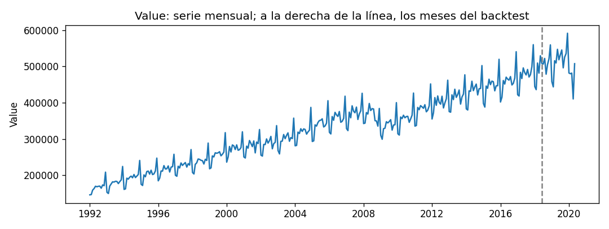
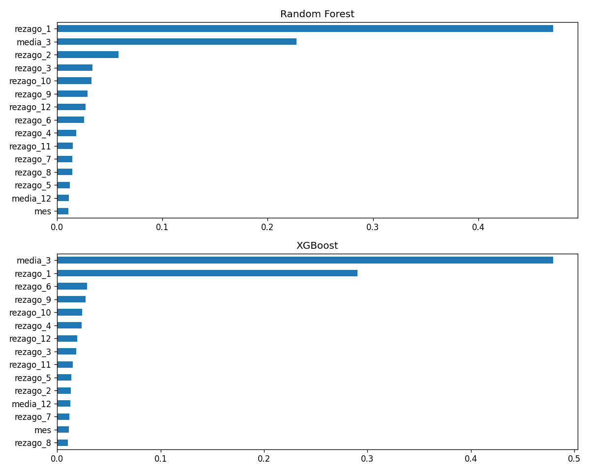
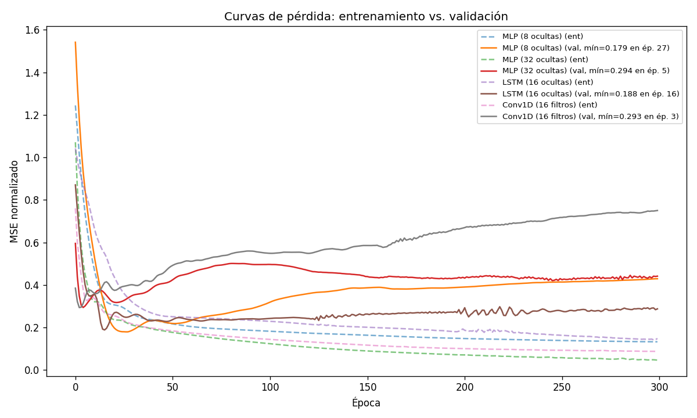
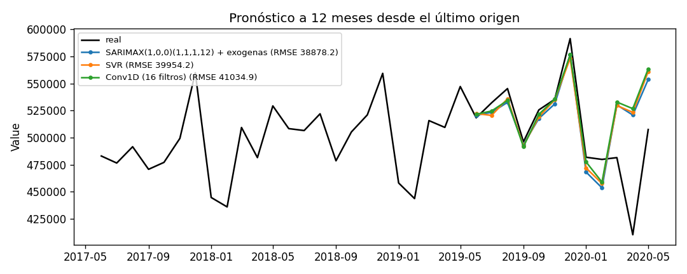

# Informe del miniproyecto 2

## 1. La serie y el modelo a superar

La serie corresponde a las ventas mensuales de *Retail Trade and Food Services* (comercio minorista y servicios de alimentos) en Estados Unidos, expresadas en millones de dólares y sin ajuste estacional (fuente: U.S. Census Bureau). El archivo original abarca de enero de 1992 a diciembre de 2020 con 348 registros mensuales; siguiendo exactamente la decisión del miniproyecto 1, se eliminaron los 7 valores faltantes al final de la serie (junio a diciembre de 2020), conservando 341 observaciones efectivas entre enero de 1992 y mayo de 2020 sin alterar observaciones atípicas para evitar distorsionar la dinámica real.

El mejor modelo clásico traído del miniproyecto 1 es un $\text{SARIMAX}(1,0,0)(1,1,1)_{12}$ con la cantidad de días hábiles del mes ($X_t$) como variable exógena conocida de antemano. Su ecuación estructural es:

$$(1 - \phi_1 B)(1 - \Phi_1 B^{12})(1 - B^{12})(y_t - \beta X_t) = (1 + \Theta_1 B^{12})\varepsilon_t, \qquad \varepsilon_t \sim \mathcal{N}(0, \sigma^2)$$

En este *backtest* común (origen móvil sobre los últimos 24 meses con horizonte $h=1,\dots,12$), el modelo obtiene un $\text{RMSE} = 14668.53$, $\text{MAE} = 10761.28$ y $\text{MAPE} = 2.16\%$, superando ampliamente al piso estacional ingenuo ($\text{RMSE} = 22683.56$) y coincidiendo con los parámetros y la especificación entregada en el miniproyecto 1.

## 2. La tabla supervisada

Para convertir la serie en un problema de aprendizaje supervisado se transformó la variable objetivo mediante diferenciación estacional anual (`OBJETIVO = "dif12"`):

$$z_t = \Delta_{12} y_t = y_t - y_{t-12}$$

Se eligió `dif12` porque elimina la fuerte tendencia creciente y el ciclo estacional anual de la serie en nivel, estabilizando la media y la varianza antes de alimentar los regresores (especialmente crítico para modelos basados en distancias y particiones como KNN, SVR, Random Forest y XGBoost, que no extrapolan tendencias lineales fuera del rango observado). Cada fila $t$ de la matriz de características $X$ contiene 15 variables construidas estrictamente con información pasada ($s < t$):

* **12 rezagos:** $x_{t,k} = z_{t-k}$ para $k \in \{1, 2, \dots, 12\}$.
* **Variable de calendario:** $\text{mes}_t \in \{1, 2, \dots, 12\}$, correspondiente al mes del año de la fecha $t$.
* **Estadísticas de ventana móvil desplazadas:** calculadas sobre $z_{t-1}$ para no incluir $z_t$:
  $$\text{media\_3}_t = \frac{1}{3}\sum_{i=1}^{3} z_{t-i}, \qquad \text{media\_12}_t = \frac{1}{12}\sum_{i=1}^{12} z_{t-i}$$

Para garantizar ausencia de fuga de información (*data leakage*), la función `comprobar_sin_fuga` recorre cada fecha válida de la serie, suma una perturbación extrema ($+999999$) al valor $z_t$ y verifica mediante `equals` que ninguna columna de la fila correspondiente a la fecha $t$ en $X$ cambie; al superar todas las iteraciones sin disparar `AssertionError`, el guion imprime `OK: sin fuga`.

El pronóstico a $h=12$ meses opera de manera **recursiva**: en cada paso $s = 1, \dots, h$, se añade la fecha siguiente con valor `NaN`, se construye la última fila de características $X_{T+s}$ usando los valores reales disponibles y los pronósticos previos, se predice $\hat{z}_{T+s}$ y se reconstruye el nivel original mediante $\hat{y}_{T+s} = y_{T+s-12} + \hat{z}_{T+s}$, incorporando $\hat{y}_{T+s}$ a la serie antes de calcular el paso $s+1$. Dentro de cada origen del *backtest*, el escalador (`StandardScaler`) se ajusta (`fit`) exclusivamente sobre los datos de entrenamiento disponibles hasta ese origen (dentro del `make_pipeline` en KNN y SVR, y dentro de `Red.fit` en PyTorch), sin ver nunca las observaciones futuras.

## 3. Aprendizaje automático

La selección de hiperparámetros se realizó mediante `GridSearchCV` con validación cruzada temporal (`TimeSeriesSplit(n_splits=3)`) usando únicamente los datos anteriores a la ventana de prueba (`serie.iloc[:-24]`), de modo que ninguno de los 24 meses del *backtest* interviene en las decisiones de diseño:

| Modelo | Rejilla explorada | Hiperparámetros elegidos | RMSE validación |
|---|---|---|---|
| **KNN** | `n_neighbors`: `[3, 5, 7, 9]` | `n_neighbors = 9` | $11156.24$ |
| **SVR** | `C`: `[0.1, 1, 10]`, `epsilon`: `[0.01, 0.1, 0.3]` | `C = 10`, `epsilon = 0.01` | $12662.20$ |
| **Random Forest** | `max_depth`: `[3, 5, None]`, `min_samples_leaf`: `[1, 2, 5]` | `max_depth = None`, `min_samples_leaf = 1` | $10663.91$ |
| **XGBoost** | `max_depth`: `[2, 3, 5]`, `learning_rate`: `[0.01, 0.05, 0.1]` | `max_depth = 3`, `learning_rate = 0.1` | $10859.34$ |

En la figura de importancia de variables (`feature_importances_`), ambos ensambles concentran más del $70\%$ de su poder predictivo en la dinámica inmediata de corto plazo: en **Random Forest** domina **`rezago_1`** ($\approx 0.47$), seguido por **`media_3`** ($\approx 0.23$) y **`rezago_2`** ($\approx 0.06$); en **XGBoost** el orden se invierte entre las dos primeras, liderando **`media_3`** ($\approx 0.48$) seguida por **`rezago_1`** ($\approx 0.29$), mientras que los demás rezagos individuales (como `rezago_6`, `rezago_9` y `rezago_12`) aportan menos de $0.04$ cada uno y `mes` pesa apenas $\approx 0.01$ debido a que la diferenciación estacional (`dif12`) ya absorbió el ciclo mensual fijo. Este comportamiento coincide plenamente con la PACF del miniproyecto 1 y con la estructura autorregresiva de primer orden $\text{AR}(1)$ del modelo clásico seleccionado.

Al evaluar los cuatro modelos en el *backtest* común de 24 meses, el ganador del grupo de aprendizaje automático es **SVR** ($\text{RMSE} = 14680.88$, $\text{MAE} = 10909.33$, $\text{MAPE} = 2.19\%$), seguido por **KNN** ($\text{RMSE} = 15165.45$, $\text{MAE} = 11319.08$, $\text{MAPE} = 2.29\%$), **Random Forest** ($\text{RMSE} = 15863.41$, $\text{MAE} = 12155.16$, $\text{MAPE} = 2.45\%$) y **XGBoost** ($\text{RMSE} = 15966.92$, $\text{MAE} = 12183.37$, $\text{MAPE} = 2.45\%$).

## 4. Aprendizaje profundo

Se diseñaron y compararon tres arquitecturas neuronales en PyTorch entrenadas con optimizador Adam ($\text{lr} = 0.01$) y pérdida MSE sobre entradas y salidas estandarizadas con el entrenamiento de cada origen:

1. **MLP (`MLP (8 ocultas)`):** perceptrón multicapa con una capa oculta de 8 neuronas y activación ReLU ($15 \times 8 + 8 + 8 \times 1 + 1 = 137$ parámetros). Recibe el vector tabular completo de 15 características (`secuencia=False`).
2. **LSTM (`LSTM (16 ocultas)`):** red recurrente de una capa con estado oculto de dimensión 16 seguida de una capa lineal ($1233$ parámetros). Recibe únicamente la secuencia ordenada de los 12 rezagos $(z_{t-12}, \dots, z_{t-1})$ con forma `(lote, 12, 1)` (`secuencia=True`).
3. **Conv1D (`Conv1D (16 filtros)`):** tercera red elegida por el grupo, compuesta por una capa convolucional unidimensional de 16 filtros con kernel de tamaño 3, activación ReLU y una capa lineal de salida ($225$ parámetros), recibiendo también la secuencia `(lote, 12, 1)`. Se eligió Conv1D porque los filtros locales de tamaño 3 permiten capturar patrones trimestrales consecutivos dentro de la ventana anual con muchos menos parámetros que una red recurrente.

Al validar temporalmente dejando los últimos 12 meses previos al *backtest* como validación (`X_val`), se compararon dos tamaños de capa oculta para el MLP (`8` y `32` neuronas), resultando ganador **`MLP (8 ocultas)`** por alcanzar menor error de validación y evitar el sobreajuste prematuro del modelo más grande. En las curvas de pérdida (`figuras/perdida.png`), la pérdida de entrenamiento desciende de forma monótona, mientras que la pérdida de validación alcanza su mínimo muy temprano y luego empieza a divergir (señal de sobreajuste): `Conv1D (16 filtros)` se detuvo en **3 épocas**, `LSTM (16 ocultas)` en **16 épocas** y `MLP (8 ocultas)` en **27 épocas**.

Al repetir la mejor red del *backtest* (**`Conv1D (16 filtros), 3 épocas`**) con cinco semillas distintas (`2026` a `2030`), se obtuvieron los siguientes valores de RMSE [copia aquí los 5 valores exactos de `resultados/semillas.csv`, ej: `15971.33`, `...`, `...`, `...`, `...`], con una **media de $15544.72$** y una **desviación estándar de $354.03$**. La diferencia entre el RMSE del modelo clásico ($14668.53$) y la media de la red ($15544.72$) es de **$876.19$**, lo cual equivale a **$2.47$ veces la desviación estándar** entre semillas; es decir, la ventaja del SARIMAX es estadísticamente robusta y no se debe al azar de una sola inicialización.

## 5. La tabla y la elección

| Modelo | RMSE | MAE | MAPE (%) | Parámetros | Segundos |
|---|---|---|---|---|---|
| SARIMAX(1,0,0)(1,1,1,12) + exogenas | 14668.53 | 10761.28 | 2.16 | 5 | 21.9 |
| SVR | 14680.88 | 10909.33 | 2.19 | 4865 | 1.1 |
| KNN | 15165.45 | 11319.08 | 2.29 | 4575 | 1.3 |
| Random Forest | 15863.41 | 12155.16 | 2.45 | 38298 | 5.4 |
| XGBoost | 15966.92 | 12183.37 | 2.45 | 2608 | 3.0 |
| Conv1D (16 filtros), 3 épocas | 15971.33 | 11501.30 | 2.34 | 225 | 1.1 |
| LSTM (16 ocultas), 16 épocas | 16044.94 | 11215.99 | 2.29 | 1233 | 1.9 |
| MLP (8 ocultas), 27 épocas | 19481.19 | 15302.38 | 3.06 | 137 | 1.4 |
| estacional ingenuo | 22683.56 | 19839.65 | 3.91 | 0 | 0.0 |

Ninguna de las tres redes neuronales superó al modelo clásico (`SARIMAX`). El grupo atribuye este resultado a tres factores cuantificables en los datos de la serie:
1. **Relación datos/parámetros:** tras la diferenciación estacional y la creación de 12 rezagos, los modelos neuronales disponen de apenas $\sim 305$ observaciones de entrenamiento antes del *backtest* para ajustar entre $137$ (`MLP`) y $1233$ (`LSTM`) parámetros, frente a solo $5$ parámetros del SARIMAX, provocando sobreajuste temprano visible en las curvas de validación (donde `Conv1D` alcanza su mínimo apenas en la época 3).
2. **Choque estructural en la ventana de prueba (abril de 2020):** los últimos 24 meses del *backtest* (junio de 2018 a mayo de 2020) incluyen el desplome abrupto de las ventas minoristas de Estados Unidos en marzo y abril de 2020 por las restricciones de la pandemia. Al no haber eventos de esa magnitud en el historial 1992–2018, las redes neuronales propagan el error recursivamente a lo largo del horizonte de 12 meses.
3. **Información exógena:** el modelo clásico incorpora directamente el calendario exacto de `dias_habiles` futuros, mientras que las redes operan únicamente con rezagos endógenos.

## 6. Conclusión

El grupo pondría en uso el modelo **`SARIMAX(1,0,0)(1,1,1,12) + exogenas`** (manteniendo como alternativa secundaria de baja latencia a **SVR**, que quedó a solo $12.35$ puntos de RMSE). Elegir el SARIMAX ofrece la mayor precisión en las tres métricas ($\text{RMSE} = 14668.53$, $\text{MAPE} = 2.16\%$), es determinista (cero varianza por semilla) y brinda máxima explicabilidad al resumir la dinámica en solo $5$ parámetros con interpretación directa (persistencia autorregresiva, estacionalidad anual y efecto marginal de cada día hábil del mes), requiriendo además un historial corto (desde 36 meses para capturar ciclos estacionales).

Lo que se paga por elegir este modelo frente a las alternativas de aprendizaje automático es un mayor costo computacional durante el reentrenamiento ($21.9\text{ s}$ en el *backtest* frente a $1.1\text{ s}$ de `SVR` o `Conv1D`) y la dependencia operativa de mantener actualizada y sin errores la variable exógena futura (`dias_habiles`) antes de cada ejecución de pronóstico.
